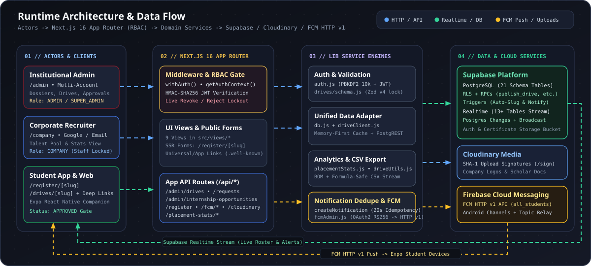
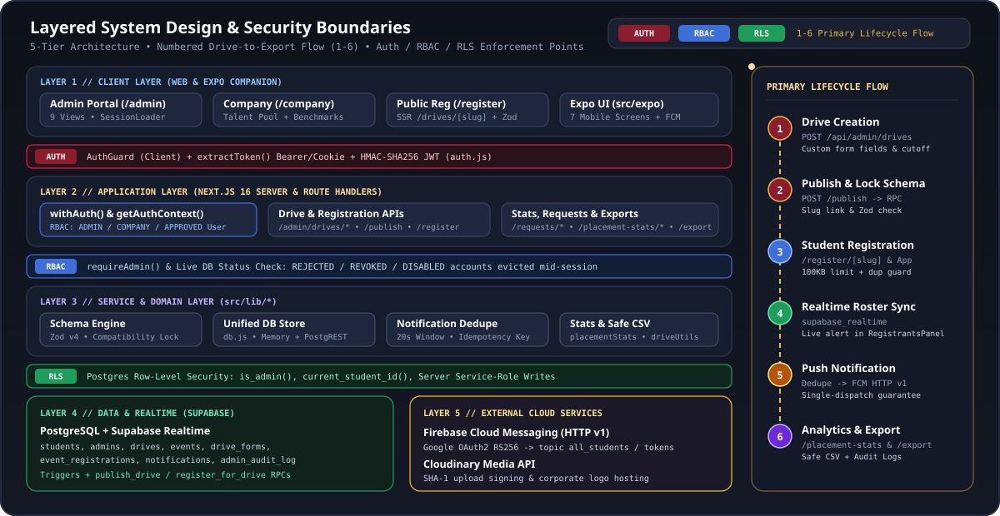

<p align="center">
  
</p>

<p align="center">
  
  
  
  
  
  
  
  
  
</p>

# RIMT Academic Trust — Training & Placement Admin Portal

An institutional **Training & Placement (T&P) Administration Portal** built with **Next.js 16** (App Router), **React 18**, **Tailwind CSS 3**, **Supabase PostgreSQL / Realtime**, **Firebase Cloud Messaging (HTTP v1)**, and **Cloudinary**, paired with public student registration routes, a role-gated corporate recruiter workspace, and companion **Expo React Native** admin screens.

> [!NOTE]
> **Runtime & Framework Alignment:** `package.json` currently pins `next: ^16.4.6` with `react: ^18.3.1` and `react-dom: ^18.3.1`. Next.js 16 targets Node.js `>=20.9.0` and deprecates React 18 support ahead of Next.js 17, so Node `20.9+` is required locally even though React 18 remains installed.

---

## 📑 Table of Contents

- [Core Features](#-core-features)
- [System Architecture](#️-system-architecture)
- [System Design](#-system-design)
- [Tech Stack & Languages](#-tech-stack--languages)
- [Project Structure](#-project-structure)
- [Getting Started](#-getting-started)
- [Security & Credential Handling](#-security--credential-handling)
- [Documentation](#-documentation)
- [Contributing](#-contributing)
- [Contributors](#-contributors)
- [License](#-license)

---

## ⚡ Core Features

- **Recruitment Drive & Event Management (`/admin`, `src/views/DriveManagement.jsx`)**
  - Create, edit, duplicate drafts, publish, reschedule, close, or cancel campus drives and college events (`PLACEMENT`, `CULTURAL`, `TECHNICAL`, `WORKSHOP`, `SEMINAR`, `SPORTS`, `CUSTOM`).
  - Dynamic **Form Builder** (`src/lib/drives/schema.js`) powered by Zod v4 validation with strict schema-compatibility checks (`assertSchemaCompatible`) once registrations exist.
  - Server-rendered public registration routes at `/register/[slug]` and `/drives/[slug]` plus Apple Universal Links / Android App Links (`public/.well-known/`).
  - Live registrant tables (`RegistrantsPanel`) synchronized via Supabase Realtime (`postgres_changes` + broadcast events).

- **Gated Student Onboarding & Scholar Dossiers (`OnboardingApprovals`, `StudentManagement`)**
  - Verification workflow transitioning candidate accounts across `PENDING`, `APPROVED`, `REJECTED`, and `REVOKED` states with mandatory audit attribution (`admin_audit_log`).
  - Live status guard in `src/lib/middleware.js` (`withAuth`) queries active account state on protected requests so rejected or revoked accounts are locked out immediately mid-session.
  - Complete scholar dossier tracking profiles, academic summaries (manual CGPA, attendance, backlogs), semester grades, GitHub/portfolio projects, certificates, and internships.

- **Corporate Recruiter Portal & Talent Directory (`CompanyManagement`, `/company`)**
  - Dual-portal authentication supporting both institutional staff (`ADMIN` / `SUPER_ADMIN`) and corporate recruiters (`COMPANY` via email/password or Google recruiter login endpoint).
  - Automatic module-level RBAC locks administrative modules (`approvals`, `students`, `drives`, `trainings`, `internships`, `reports`) for `COMPANY` accounts while exposing the verified Talent Pool showcase and placement benchmarks.
  - Server-side corporate logo upload endpoint (`/api/company/upload-logo`) and client upload signing (`/api/cloudinary/sign`) backed by Cloudinary.

- **Internship Opportunities & Monitoring (`InternshipMonitoring`)**
  - Admin CRUD workspace for campus internship postings (`internship_opportunities`) enforcing mutually exclusive compensation models (`stipend`, `paid`, `non_stipend`), duration bounds (`1–24` months), and deduplicated skill normalization (`src/lib/internshipValidation.js`).
  - Student internship credit and mentor progress monitoring synchronized with `student_internships`.

- **Deduplicated Notifications & Push Dispatch (`src/lib/db.js`, `src/lib/fcmAdmin.js`)**
  - Database-backed notifications (`notifications`, `student_notification_reads`) paired with idempotency keys and a 20-second server deduplication window in `createNotification()`.
  - Google OAuth 2.0 RS256 service-account exchange dispatching Firebase Cloud Messaging HTTP v1 notifications to the `all_students` topic and stored `fcm_tokens` records.

- **Placement Analytics, Training & Compliance Exports (`PlacementStatistics`, `TrainingManagement`, `ReportGeneration`)**
  - Real-time KPIs, CTC tier breakdowns, sector distributions, 4-year placement trends, and hiring-partner metrics via `/api/placement-stats/*`.
  - UTF-8 BOM CSV exports (`/api/admin/drives/[id]/registrations/export` and `src/lib/driveUtils.js`) with CSV formula-injection neutralization.
  - Companion React Native / Expo UI screens in `src/expo/`.

---

## 🏛️ System Architecture

<p align="center">
  
</p>

1. **Client Actors**: Administrators access `/admin` (multi-account switcher + full operations), Corporate Recruiters access `/company` (restricted to Talent Pool and Statistics), and students connect via public web forms (`/register/[slug]`, `/drives/[slug]`) or the Expo mobile client.
2. **Next.js 16 App Router**: Serves modular React views, SSR public registration forms, and serverless Route Handlers under `src/app/api/*`, guarded by `withAuth()` and `getAuthContext()`.
3. **Domain & Service Layer (`src/lib/`)**: Handles PBKDF2-SHA256 password hashing & HMAC-SHA256 JWTs (`auth.js`), memory-first caching with Supabase PostgREST persistence (`db.js`, `driveClient.js`), Zod v4 form locking (`drives/schema.js`), CSV formatting (`driveUtils.js`), placement aggregations (`placementStats.js`), and FCM dispatch (`fcmAdmin.js`).
4. **Cloud Infrastructure**:
   - **Supabase** provides PostgreSQL storage (tables, RLS policies, RPCs, triggers), `supabase_realtime` streaming across core tables, Auth verification, and certificate storage policies.
   - **Cloudinary** handles signed upload tokens (`/api/cloudinary/sign`) and corporate partner logo uploads (`/api/company/upload-logo`).
   - **Firebase Cloud Messaging (HTTP v1)** relays push alerts from server routes to student Android/Expo devices.

---

## 🧩 System Design

<p align="center">
  
</p>

### Primary Lifecycle Flow (Steps 1–6)

1. **Drive Creation**: An authenticated `ADMIN` creates a drive or event via `POST /api/admin/drives` with eligibility rules, SPOC metadata, and custom form fields.
2. **Publish & Schema Lock**: `POST /api/admin/drives/[id]/publish` validates the schema with Zod v4, verifies backwards compatibility via `assertSchemaCompatible()` if applicants exist, and invokes the `publish_drive` PostgreSQL RPC to issue a public `/drives/[slug]` or `/register/[slug]` URL.
3. **Student Registration**: Students submit SSR-rendered or mobile forms (`POST /api/register`, `POST /api/drives/[slug]/register`, or `register_for_drive` RPC), enforcing a 100 KB payload cap and unique student-per-event constraints.
4. **Realtime Roster Sync**: PostgreSQL changes on `event_registrations` / `drive_registrations` and Realtime broadcasts stream directly into `RegistrantsPanel`.
5. **Deduplicated Push Notification**: Announcements trigger `createNotification()`, enforcing idempotency-key deduplication before issuing a single FCM HTTP v1 broadcast to `all_students` and `fcm_tokens`.
6. **Analytics & Export**: Placement metrics aggregate live approved scholar records via `/api/placement-stats/*`, while admins export formula-safe UTF-8 CSV rosters via `/api/admin/drives/[id]/registrations/export`.

### Enforcement Boundaries

- **Authentication**: Browser sessions store bearer tokens paired with `AuthGuard`; server routes verify HMAC-SHA256 JWTs (`auth.js`) or Supabase Auth JWTs (`drives/authHelper.js`).
- **RBAC**: `withAuth()` restricts staff routes to `ADMIN` / `SUPER_ADMIN`, restricts `COMPANY` accounts to Talent Pool & Statistics, and validates live `APPROVED` status on student sessions.
- **PostgreSQL RLS**: Database policies rely on `public.is_admin()` and `public.current_student_id()` helpers; administrative mutations require a server-side service-role client.

---

## 🛠️ Tech Stack & Languages

| Layer | Technology | Role in Repository |
|---|---|---|
| **Framework** | Next.js `^16.4.6` | App Router, SSR registration pages, serverless API routes |
| **UI Runtime** | React `^18.3.1` & Tailwind CSS `^3.4.19` | Modular dashboard views (`src/views/*`) and design tokens |
| **Database & Realtime** | Supabase (`@supabase/supabase-js` `^2.117.2`) | PostgreSQL schemas, RLS policies, RPCs, triggers, Realtime sync |
| **Validation** | Zod `^4.6.7` | Dynamic form schema definition, coercion, compatibility guards |
| **Icons** | `lucide-react` `^0.424.0` + Material Symbols | Administrative UI and status iconography |
| **Push Messaging** | Firebase Cloud Messaging (HTTP v1) | Topic/device notifications via Google OAuth 2.0 RS256 service account |
| **Media Hosting** | Cloudinary REST API | Upload signature generation and corporate logo uploads |
| **Mobile UI Module** | Expo React Native (`src/expo/`) | Shared companion navigator and 7 mobile admin screens |
| **Testing** | Native Node ESM runner (`node tests/*.test.mjs`) | 8 test files verifying auth, schemas, drives, FCM dedupe, dossiers, internships |

### Language Breakdown

<p align="center">
  
</p>

*Measured across 44,945 tracked source lines (excluding `node_modules/`, `.next/`, `package-lock.json`, fonts, images, and `.well-known` manifests):*

| Language | Share | Line Count | Primary Usage |
|---|---:|---:|---|
| **JavaScript / React JSX** (`.jsx`, `.js`, `.mjs`) | **86.98%** | 39,094 | Views, components, App Router APIs, Expo screens, `src/lib/*`, ESM tests |
| **Markdown** (`.md`) | **7.38%** | 3,315 | Architectural specs, API handoffs, runbooks, and `README.md` |
| **PostgreSQL / SQL** (`.sql`) | **4.30%** | 1,932 | `src/lib/schema.sql`, Realtime script, and `supabase/migrations/*.sql` |
| **CSS** (`.css`) | **1.23%** | 555 | `src/styles/globals.css` Tailwind layers and loader animations |
| **JSON & Config** (`.json`, `.gitignore`, `.env.example`) | **0.11%** | 49 | `package.json`, `jsconfig.json`, `cspell.json`, ignore & env templates |

---

## 📁 Project Structure

```text
T-P-ADMIN-PORTAL/
├── docs/
│   ├── assets/                        # Animated SVGs used in README.md
│   │   ├── banner.svg
│   │   ├── architecture-flow.svg
│   │   ├── system-design.svg
│   │   └── languages.svg
│   ├── drive-management/
│   │   ├── API.md                     # Drive management REST & RPC contract
│   │   ├── ASSUMPTIONS.md             # Stack assumptions & architectural notes
│   │   └── MANUAL_STEPS.md            # Supabase & mobile deep-link setup steps
│   ├── ADMIN.md                       # Master operational & architecture spec
│   ├── AGENTS.md                      # Next.js agent guidance notice
│   ├── CLAUDE.md                      # Reference pointer to AGENTS.md
│   ├── FULL-APP.md                    # Paired student Expo app specification
│   ├── RESUMEE.md                     # CVForge UI prototype specification
│   └── drive.md                       # Drive module frontend specification
├── public/
│   ├── .well-known/                   # iOS Universal Links & Android App Links
│   ├── fonts/                         # Bundled Material Symbols icon font
│   ├── campus-banner.jpg
│   └── rimt-logo.png
├── src/
│   ├── app/
│   │   ├── admin/                     # Staff portal, login, multi-account setup
│   │   ├── api/                       # Next.js Route Handlers (auth, drives, requests, fcm, stats, cloudinary)
│   │   ├── company/                   # Corporate recruiter workspace & auth
│   │   ├── drives/[slug]/             # Public drive landing & registration flow
│   │   ├── register/[slug]/           # SSR public event registration form
│   │   ├── layout.jsx                 # Root layout, head splash guard, preloads
│   │   ├── loading.jsx                # Route transition fallback
│   │   └── page.jsx                   # Authenticated multi-module dashboard shell
│   ├── components/
│   │   ├── auth/                      # AuthGuard, AuthScreen
│   │   ├── common/                    # CompanyBrandLogo, SessionLoader
│   │   ├── drive/                     # FormBuilderPanel, RegistrantsPanel, DriveDetailDrawer, ResultsPanel, etc.
│   │   ├── internship/                # Filters, OpportunityCard, OpportunityFormModal, StudentInternshipCard
│   │   ├── placement/                 # HiringCompaniesSection, PlacedStudentsCard
│   │   ├── profile/                   # AddAccountModal, ProfileMenu, ProfileModal
│   │   ├── student/                   # StudentDossierModal, StudentLinkedInProfileModal, TalentProfileModal
│   │   └── ...                        # FilterPills, Header, HeroCard, KpiCard, Modal, Sidebar
│   ├── constants/                     # Theme tokens & reference datasets (data.js, tokens.js)
│   ├── expo/                          # Expo React Native navigator + 7 admin screens
│   ├── lib/
│   │   ├── drives/                    # authHelper.js, schema.js (Zod form compatibility engine)
│   │   ├── auth.js                    # Web Crypto PBKDF2-SHA256 & HMAC-SHA256 JWT
│   │   ├── authApi.js                 # Browser auth & multi-account session client
│   │   ├── db.js                      # Memory-first store + Supabase PostgREST adapter
│   │   ├── driveClient.js             # Drive API client + fallback handlers
│   │   ├── driveUtils.js              # Status badges, validation, schedule diff, CSV export
│   │   ├── enable_realtime.sql        # Idempotent supabase_realtime publication script
│   │   ├── fcmAdmin.js                # Google OAuth2 RS256 -> FCM HTTP v1 sender & topic manager
│   │   ├── internshipValidation.js    # Compensation & duration rules
│   │   ├── middleware.js              # withAuth() RBAC & live status guard
│   │   ├── placementStats.js          # Summary, trend, tier, and company hiring analytics
│   │   ├── schema.sql                 # Base onboarding & admin auth SQL schema
│   │   └── supabaseClient.js          # Shared browser/server Supabase client
│   ├── styles/                        # globals.css
│   └── views/                         # 9 dashboard modules (Onboarding, Students, Companies, Drives, Stats, etc.)
├── supabase/
│   └── migrations/                    # 9 additive SQL migrations (dossiers, drives, events, fcm_tokens, etc.)
├── tests/                             # 8 standalone ESM unit test files (196 passing checks)
├── .env.example                       # Environment template (Cloudinary variables)
├── .gitignore
├── jsconfig.json
├── next.config.js
├── package.json
├── postcss.config.js
├── README.md
└── tailwind.config.js
```

---

## 🚀 Getting Started

### 1. Prerequisites

- **Node.js `>= 20.9.0`** and **npm** (required by Next.js 16; `package.json` does not currently declare an `engines` field)
- A **Supabase** project (PostgreSQL database, Realtime enabled, optional Storage bucket)
- *(Optional, for push alerts)* A **Firebase** project with a Service Account JSON for FCM HTTP v1
- *(Optional, for media signing & logo uploads)* A **Cloudinary** account

### 2. Clone the Repository

```bash
git clone https://github.com/R3DH47-ui/T-P-ADMIN-PORTAL.git
cd T-P-ADMIN-PORTAL
```

### 3. Install Dependencies

```bash
npm install
```

<details>
<summary><strong>📦 View all dependencies and devDependencies declared in <code>package.json</code></strong></summary>

| Package | Version | Type | Purpose |
|---|---|---|---|
| `next` | `^16.4.6` | dependency | App Router SSR/CSR framework & serverless API routes |
| `react` | `^18.3.1` | dependency | Component UI runtime |
| `react-dom` | `^18.3.1` | dependency | DOM renderer for Next.js React components |
| `@supabase/supabase-js` | `^2.117.2` | dependency | Supabase PostgreSQL, Auth, Storage & Realtime SDK |
| `zod` | `^4.6.7` | dependency | Dynamic drive form builder & answer schema validation |
| `lucide-react` | `^0.424.0` | dependency | Icon library across dashboard and form controls |
| `tailwindcss` | `^3.4.19` | devDependency | Utility-first CSS framework |
| `postcss` | `^8.5.28` | devDependency | CSS processing pipeline |
| `autoprefixer` | `^10.6.1` | devDependency | CSS vendor prefix automation |

</details>

### 4. Environment Configuration

Copy `.env.example` into a local `.env` file (which is gitignored):

**Linux / macOS:**
```bash
cp .env.example .env
```

**Windows (CMD / PowerShell):**
```powershell
copy .env.example .env
```

Note that `.env.example` currently declares only the Cloudinary variables. The table below documents **all** environment variables actually read across the codebase (`src/lib/*` and `src/app/api/*`). Replace every value with placeholders from your own dashboards:

| Variable Name | Where Read in Code | Scope | How to Obtain / Notes |
|---|---|---|---|
| `NEXT_PUBLIC_SUPABASE_URL` | `supabaseClient.js`, `db.js`, `fcmAdmin.js`, API routes | Public | Supabase Dashboard → Project Settings → API (`https://your-project-ref.supabase.co`) |
| `SUPABASE_URL` | `fcmAdmin.js`, `fcm/register`, `drives/[id]/notify` | Server | Server fallback for Supabase project URL (`https://your-project-ref.supabase.co`) |
| `NEXT_PUBLIC_SUPABASE_KEY` | `supabaseClient.js`, `db.js`, `authHelper.js`, API routes | Public | Supabase Dashboard → API → Publishable / `anon` key (`your_supabase_anon_key`) |
| `NEXT_PUBLIC_SUPABASE_ANON_KEY` | `drives/[id]/notify` | Public | Alternate public `anon` key name (`your_supabase_anon_key`) |
| `SUPABASE_KEY` | `fcmAdmin.js`, `fcm/register`, `drives/[id]/notify` | Server | Server fallback for Supabase key (`your_supabase_anon_or_service_key`) |
| `SUPABASE_SERVICE_ROLE_KEY` | `db.js`, `fcmAdmin.js`, `fcm/register`, `drives/[id]/notify` | **Secret (Server-Only)** | Supabase Dashboard → API → `service_role` secret (`your_supabase_service_role_key`) |
| `NEXT_PUBLIC_SERVICE_ROLE_KEY` / `NEXT_PUBLIC_SERVICE_KEY` | `db.js`, `admin/drives/route.js`, `api/register/route.js` | ⚠️ **Legacy Name (Treat as Server-Only)** | Legacy fallback names still checked in server code — **do not expose in client bundles** (see Security warning below) |
| `JWT_SECRET` | `src/lib/auth.js` | **Secret (Server-Only)** | Generate a cryptographically random 32+ byte secret (`your_jwt_signing_secret`) |
| `FIREBASE_SERVICE_ACCOUNT_KEY` | `src/lib/fcmAdmin.js` | **Secret (Server-Only)** | JSON string of Firebase Service Account (`{"project_id":"your_firebase_project_id",...}`), or place gitignored `firebase-service-account.json` at project root |
| `CLOUDINARY_CLOUD_NAME` / `NEXT_PUBLIC_CLOUDINARY_CLOUD_NAME` | `cloudinary/sign`, `company/upload-logo` | Public | Cloudinary Dashboard → Cloud Name (`your_cloud_name`) |
| `CLOUDINARY_API_KEY` | `cloudinary/sign`, `company/upload-logo` | Public/Server | Cloudinary Dashboard → API Key (`your_cloudinary_api_key`) |
| `CLOUDINARY_API_SECRET` | `cloudinary/sign`, `company/upload-logo` | **Secret (Server-Only)** | Cloudinary Dashboard → API Secret (`your_cloudinary_api_secret`) |
| `NEXT_PUBLIC_APP_URL` / `APP_URL` | `db.js`, `driveClient.js`, `drives/[id]/publish` | Public/Server | Deployed portal base URL used in generated registration links (`http://localhost:3000` locally) |
| `SEED_ADMIN_HASH_RAJ` / `SEED_ADMIN_HASH_SAGRIKA` / `SEED_ADMIN_HASH_DEAN` | `src/lib/db.js` | **Secret (Server-Only)** | Optional PBKDF2-SHA256 hex digest overrides for seeded admin profiles |

> [!CAUTION]
> **Critical Warning About `NEXT_PUBLIC_SERVICE_ROLE_KEY`:** The legacy README and server fallback checks reference `NEXT_PUBLIC_SERVICE_ROLE_KEY` (and `NEXT_PUBLIC_SERVICE_KEY`). In Next.js, any variable prefixed with `NEXT_PUBLIC_` is eligible to be inlined into browser JavaScript bundles if imported by client code, and a Supabase **service-role key bypasses all Row-Level Security (RLS)** policies. Always configure **`SUPABASE_SERVICE_ROLE_KEY`** (without the `NEXT_PUBLIC_` prefix) strictly in server environment settings and never expose a service-role key to the browser.

Example local `.env` using safe placeholders:

```ini
NEXT_PUBLIC_SUPABASE_URL=https://your-project-ref.supabase.co
NEXT_PUBLIC_SUPABASE_KEY=your_supabase_anon_key
SUPABASE_SERVICE_ROLE_KEY=your_supabase_service_role_key
JWT_SECRET=replace_with_a_long_random_hex_secret
NEXT_PUBLIC_APP_URL=http://localhost:3000

# Optional Cloudinary direct-upload signing & corporate logo upload
CLOUDINARY_CLOUD_NAME=your_cloud_name
CLOUDINARY_API_KEY=your_cloudinary_api_key
CLOUDINARY_API_SECRET=your_cloudinary_api_secret

# Optional Firebase Cloud Messaging HTTP v1 service account JSON (single-line)
FIREBASE_SERVICE_ACCOUNT_KEY={"type":"service_account","project_id":"your_firebase_project_id"}
```

### 5. Database & Realtime Setup

1. Open your **Supabase Dashboard → SQL Editor** (or link via Supabase CLI and run `supabase db push`).
2. Apply the base schema in `src/lib/schema.sql`, then apply every migration in `supabase/migrations/` in chronological order:
   - `20260930_add_student_bio_and_academic_score.sql`
   - `20260930_admin_student_dossier.sql`
   - `20260930_fixed_admin_accounts.sql`
   - `20261018_internship_opportunities.sql`
   - `20261019_scalable_notification_system.sql`
   - `20261022_drive_registration_links.sql`
   - `20261024_drive_management_forms.sql`
   - `20261031_event_management_system.sql`
   - `20261101_fcm_tokens.sql`
3. Execute `src/lib/enable_realtime.sql` in the Supabase SQL Editor to idempotently create/update the `supabase_realtime` publication and set `REPLICA IDENTITY FULL` on tracked tables.

### 6. Run, Test, and Build

| Command | Script in `package.json` | Purpose |
|---|---|---|
| `npm run dev` | `next dev` | Start local development server on [http://localhost:3000](http://localhost:3000) |
| `npm run build` | `next build` | Create optimized production build |
| `npm run start` | `next start` | Serve compiled production Next.js server |
| `npm test` | `node tests/onboarding.test.mjs && ...` | Run the 6 primary ESM test suites (113 checks) |

To run all **8 test suites (196 passing checks)** including the two standalone dossier & internship suites:

```bash
npm test
node tests/dossier-academic.test.mjs
node tests/internship-opportunities.test.mjs
```

---

## 🔒 Security & Credential Handling

- **Never commit secrets**: Keep `.env`, `.env*.local`, and `firebase-service-account.json` out of version control (all listed in `.gitignore`).
- **Keep privileged keys server-only**: `SUPABASE_SERVICE_ROLE_KEY`, `JWT_SECRET`, `FIREBASE_SERVICE_ACCOUNT_KEY`, and `CLOUDINARY_API_SECRET` must only be supplied to Node/Serverless route handlers—never in `NEXT_PUBLIC_*` client variables or Expo mobile bundles.
- **Row-Level Security (RLS)**: Maintain RLS on Supabase tables (`students`, `admins`, `student_*`, `internship_opportunities`, `notifications`, `events`, `event_registrations`, `fcm_tokens`) so anonymous/public clients only access explicitly permitted read/registration scopes.
- **Secret Rotation**: If any Supabase key, JWT secret, Cloudinary secret, or Firebase private key is ever committed or exposed in client builds, rotate/revoke it immediately in the respective provider dashboard and replace it via environment variables.
- **Reporting Vulnerabilities**: Do **not** open public GitHub issues for security bugs or credential leaks. Report vulnerabilities privately via GitHub **Security Advisories** (`Security → Advisories → Report a vulnerability`) or by contacting the repository maintainers directly.

---

## 📚 Documentation

Verified documentation inside [`docs/`](./docs):

- [`docs/ADMIN.md`](./docs/ADMIN.md) — Institutional portal architecture, modules, and operational workflows
- [`docs/drive.md`](./docs/drive.md) — Drive Management UI & lifecycle specification
- [`docs/drive-management/API.md`](./docs/drive-management/API.md) — Drive API & Supabase RPC handoff contract
- [`docs/drive-management/ASSUMPTIONS.md`](./docs/drive-management/ASSUMPTIONS.md) — Drive implementation assumptions & schema references
- [`docs/drive-management/MANUAL_STEPS.md`](./docs/drive-management/MANUAL_STEPS.md) — Production Supabase migration & Universal/App Links guide
- [`docs/FULL-APP.md`](./docs/FULL-APP.md) — Paired Expo student mobile companion specification
- [`docs/RESUMEE.md`](./docs/RESUMEE.md) — CVForge resume builder design specification
- [`docs/AGENTS.md`](./docs/AGENTS.md) & [`docs/CLAUDE.md`](./docs/CLAUDE.md) — Repository assistant & Next.js notes

---

## 🤝 Contributing

1. Branch off `main` using descriptive branch prefixes (`feature/...`, `fix/...`, `refactor/...`, or `docs/...`).
2. Follow Conventional Commit messages matching repository history (e.g., `fix(db): ...`, `refactor(structure): ...`, `docs(readme): ...`).
3. Ensure all 8 test suites in `tests/` pass before opening a Pull Request against `main`.
4. Never stage `.env*`, service account JSONs, or unrelated local changes in your commits.

---

## 👥 Contributors

- [@Innosphere5](https://github.com/Innosphere5)
- [@R3DH47-ui](https://github.com/R3DH47-ui)

---

## 📄 License

License not specified.
